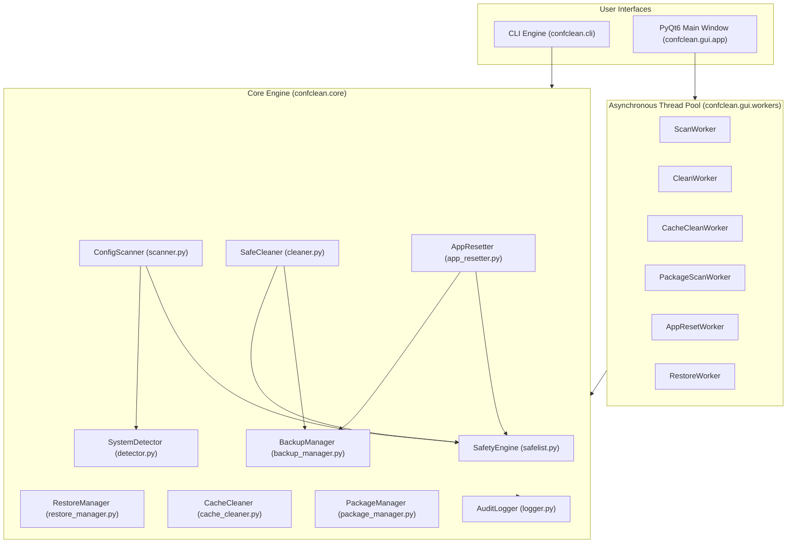
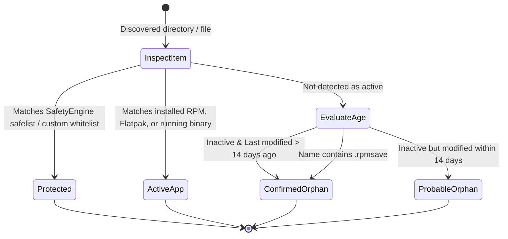
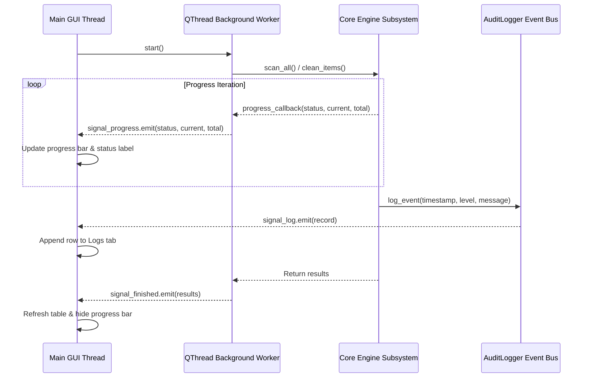

# ConfClean FC Architecture & Internals 🏛️⚙️

This document outlines the software design, component interactions, multi-threading architecture, and data pipelines powering **ConfClean FC**.

> [!NOTE]
> **Development Status**: ConfClean FC is currently in **BETA**. Architectural components, interfaces, and safelist patterns are actively maintained and hardened against system edge cases.

---

## 🏗️ High-Level System Architecture

ConfClean FC is designed with a strict **separation of concerns** between core system logic (`confclean.core`) and the graphical user interface (`confclean.gui`). All business logic, safety checks, scanning heuristics, and backup management are completely headless and can be invoked either by the Qt6 GUI or by the CLI engine.



---

## 🔍 Core Subsystems Breakdown

### 1. Fast Detection Engine (`confclean.core.detector.SystemDetector`)
To prevent the scanning phase from stalling on thousands of installed RPM packages, `SystemDetector` interfaces directly with the native C-bindings of `python-rpm`:
* **RPM Transaction Set (`rpm.TransactionSet`)**: Queries all installed packages (often 3,000+) in under 50ms without shelling out to slow subprocesses.
* **Flatpak Detection**: Inspects installed Flatpak apps via `flatpak list --app --columns=application`.
* **Path Binaries**: Scans `/usr/bin`, `/usr/sbin`, `/usr/local/bin`, and `~/.local/bin` for standalone binaries.
* **Running Processes**: Scans active process names from `/proc` to guarantee that active daemon processes are recognized immediately.
* **Desktop File Index**: Parses `.desktop` files in `/usr/share/applications` and `~/.local/share/applications` to capture application names, binary executions, and icon associations.

### 2. Deep Configuration Scanner (`confclean.core.scanner.ConfigScanner`)
The scanner traverses standard XDG base directory specifications and system configuration trees:
* `~/.config/` (User application configurations)
* `~/.local/share/` (User application runtime data)
* `~/.var/app/` (Sandboxed Flatpak application settings)
* `~/.local/share/applications/` and `~/.config/autostart/` (Broken desktop launchers and autostart entries whose target executables no longer exist)
* `/etc/*.rpmsave` and `/etc/*.rpmnew` (System configuration backups left behind after RPM package removals or updates)

#### Broken Desktop & Autostart Detection:
The scanner inspects user-level `.desktop` entries in application menus and autostart directories. By parsing the `Exec=` key and resolving binary locations against `PATH`, any launcher referencing missing executables is flagged with category `"Broken Desktop"` and status `CONFIRMED_ORPHAN`.

#### Built-in RPM Diff Engine (`get_rpm_diff` & `RpmDiffDialog`):
For `.rpmnew` and `.rpmsave` files, ConfClean FC provides a unified diff engine comparing the template against the live `/etc` configuration file. In the GUI, double-clicking any RPM upgrade candidate opens an interactive diff viewer dialog (`RpmDiffDialog`) featuring syntax-highlighted diff hunks (additions, deletions, line numbers) and one-click clipboard copying.

#### Item Classification State Machine:


### 3. Safe Deletion & Pre-Backup Pipeline (`confclean.core.cleaner.SafeCleaner`)
When items are marked for removal, `SafeCleaner` executes a deterministic pipeline:
1. **Safelist Assertion**: Before touching anything, each item is re-validated against `SafetyEngine.is_safelisted(path)`. Any item matching a protected pattern is immediately blocked and skipped.
2. **Dry Run Interception**: If `dry_run=True` (the default across both CLI and GUI), the operation calculates total reclaimable bytes, logs the simulated targets, and exits without modifying the filesystem.
3. **Pre-Deletion Compressed Backup**:
   * An archive is generated at `~/.local/share/confclean-fc/backups/confclean_backup_<YYYYMMDD_HHMMSS>.tar.gz`.
   * A structured `manifest.json` is embedded into the root of the archive.
   * If archive creation fails (e.g. insufficient disk space), deletion is **aborted immediately**.
4. **Item Removal**:
   * Directories are removed via `shutil.rmtree()`.
   * Files and symlinks are removed via `os.remove()`.
5. **Audit Logging**: Each removal is recorded in `~/.local/share/confclean-fc/logs/audit.log` with timestamp, absolute path, size, and status.

### 4. Backup & Restore Architecture (`confclean.core.backup_manager` & `restore_manager`)

#### Embedded `manifest.json` Structure:
```json
{
  "backup_id": "confclean_backup_20261029_110021",
  "created_at": "2026-10-29T11:00:21",
  "user": "turajb",
  "os": "Fedora Linux 44 (Workstation Edition)",
  "total_items": 12,
  "total_bytes": 1048576,
  "items": [
    {
      "id": "item_0001",
      "archive_member": "item_0001/asunder",
      "original_path": "/home/turajb/.config/asunder",
      "name": "asunder",
      "is_directory": true,
      "size_bytes": 1024,
      "reason": "Uninstalled application configuration"
    }
  ]
}
```

The **Restore Engine** supports:
* **Full Archive Restoration**: Restores all items in the archive back to their exact original paths.
* **Selective Item Restoration**: Restores only selected items matching an item ID.
* **Conflict Management**: User can choose between skipping existing files or overwriting them with the backed-up version.

### 5. Multi-System Package Optimization (`confclean.core.package_manager.PackageManager`)
* **Running Kernel Safeguard**: Evaluates `uname -r` and flags the currently active booted kernel as **PROTECTED**.
* **Fallback Kernel Safeguard**: Identifies the newest installed kernel alternative (e.g. `kernel-core-6.x`) and flags it as **PROTECTED** to ensure the user always has a bootable fallback.
* **Redundant Old Kernels**: Older redundant kernels (3rd or older) are classified as cleanable candidates.
* **DNF Unneeded Dependencies**: Queries `dnf repoquery --unneeded` or `dnf autoremove` candidates, cross-checks against protected system libraries, and outputs safe removal commands.
* **Flatpak Unused Runtime Pruning**: Automatically detects unreferenced runtimes (`flatpak list --runtime --unused`) and suggests cleanup via `flatpak uninstall --unused -y`. Degrades gracefully if Flatpak is not installed.
* **Snap Disabled Revision Pruning**: Queries old disabled Snap revisions (`snap list --all`) and schedules pruning of non-active revisions. Degrades gracefully if Snap is not installed.
* **Single-Authentication Privilege Batching**: When multiple packages require root privileges across DNF and Snap, `get_removal_command` coalesces commands into a single compound execution (e.g., `pkexec bash -c "cmd1 && cmd2"`) so the user enters their administrator password only once per batch operation.

### 6. Application Factory Resetter (`confclean.core.app_resetter.AppResetter`)
Allows wiping accumulated caches, broken preferences, and local cookies to return applications (e.g., Firefox, Chrome, VS Code, LibreOffice, GIMP, VLC, Flatpaks) to fresh-install defaults.
* **Automatic Pre-Reset Archive**: A dedicated backup is automatically archived before wiping the target application folders.
* **Selective Reset**: Wipes config/cache without removing application binaries or document files.

---

## 🧵 PyQt6 GUI Multi-Threading Model

All disk-intensive and scanning operations run in separate background `QThread` workers to maintain smooth 60 FPS UI responsiveness:



### Worker Classes in `confclean.gui.workers`:
1. `ScanWorker`: Executes `ConfigScanner.scan_all()` in the background.
2. `CleanWorker`: Executes `SafeCleaner.clean_items()`.
3. `CacheCleanWorker`: Executes `CacheCleaner.clean_category()`.
4. `PackageScanWorker`: Executes `PackageManager.scan_all_suggestions()`.
5. `AppResetWorker`: Executes `AppResetter.reset_app()`.
6. `RestoreWorker`: Executes `RestoreManager.restore()`.
